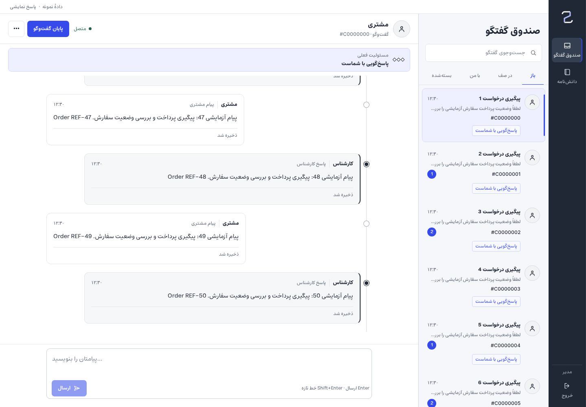

# Phase 1 — operator Inbox verification

Date: 2026-10-31. Branch: `arena/9041878a-support-desk`. Review only; do not merge.

> Final verification: [CI stabilization and repeated integrated results](stabilization.md).
> Follow-up: [CI/regression review](ci-review.md) records the staff source breakpoint
> correction, added coverage and current merge blockers. Initial evidence below is retained.

## Evidence boundary

These are **fresh screenshots of the actual React application with browser-intercepted,
synthetic API/session fixtures** (`apps/web/e2e/inbox-responsive.spec.ts`). They are not
concept mockups or historical screenshots. They do **not** establish real authenticated
workflow success. Realtime transport is stubbed; all conversation content and identities
are fictional. The product's sample-data/simulated-response disclosure remains visible.
The mobile screenshot deliberately includes an existing failed-send/retry scenario and
a preserved second draft; that error is expected, not a functioning backend claim.

Docker and uv are unavailable in this environment. Existing backend-integrated E2E suites
were not run. Real login, authorization/ownership transitions, successful delivery,
provider behavior, durable server state and production-browser integration remain gates.

## Implemented and tested

| Check | Result |
| --- | --- |
| Desktop index / rail widths | 1120/1280/1439: 304/84; 1440/1599: 320/92; 1600/1920: 344/92 |
| Narrow direct Inbox entry, including restored selection | List shown at 390, 768, 1024, 1119 |
| Live resize | 1440 → 1120 → 1119 → 1120 → 1440 → 390; selected detail, draft and pending message retained |
| Reader position through 1119/1120 | Message ID anchor and offset retained (under 3px drift in fixture checks) |
| Routes | Back/Forward and visible Back preserve query, pressed filter, list scroll and composer draft; Back restores row focus |
| Older transcript after switching conversations | Existing history endpoint rehydrates missing saved message anchor; ID/offset restored |
| Pending send after route change and reload | Existing failed-send/retry item restored from IndexedDB; no delivery-contract edits |
| Filters | Labeled group, native buttons, one aria-pressed=true, keyboard Space, visible labels, ≥44px heights; unchanged controller/assigned_actor_id/status parameters |
| Overflow | Document horizontal overflow absent in all tested widths/scenarios |
| Scoped storage | Defaults/corruption/denied storage; actor/workspace/conversation isolation; logout-cleared namespace |

No source-inspector lifecycle, real citation retrieval, customer workflow or Knowledge
browser regression is claimed. New CSS is limited to `.staff-desk` / `.inbox-workspace`;
shared Timeline preservation is staff-gated. At initial implementation, the source policy was unchanged. The focused CI review
subsequently corrected the staff breakpoint to reuse the existing dialog below1440;
see the linked investigation. Customer source behavior and other source redesigns
remain unchanged/deferred.

## Screenshots

All filenames are prefixed `frontend-fixture-` to retain the evidence distinction.
Captures are native viewport sizes, not resized historical comparisons.

- [1120 × 1000 — persistent panes](frontend-fixture-inbox-1120.png)
- [1280 × 1000 — 304px index](frontend-fixture-inbox-1280.png)
- [1440 × 1000 — 320px index](frontend-fixture-inbox-1440.png)
- [1920 × 1000 — 344px index](frontend-fixture-inbox-1920.png)
- [1119 × 900 — list view](frontend-fixture-list-1119.png)
- [390 × 844 — selected detail, failed-send scenario and draft](frontend-fixture-inbox-390.png)



## Reproduction and results

With the frontend development server on port 5173 (no backend needed for this suite):

```sh
pnpm --filter @supportdesk/web test
pnpm --filter @supportdesk/web typecheck
pnpm --filter @supportdesk/web lint
pnpm --filter @supportdesk/web build
CHROME_PATH=/path/to/chromium pnpm --filter @supportdesk/web exec playwright test e2e/inbox-responsive.spec.ts --reporter=line
```

Results: **25 unit tests and 15 fixture browser tests passed**, typecheck/lint/build passed.
The suite disables video locally to avoid requiring ffmpeg; existing E2E configuration
is otherwise unchanged. This sandbox used Chromium at `/tmp/chromium`, with
`LD_LIBRARY_PATH=/home/user/.desktop-tools/runtime/lib`, and external pnpm 11.20.0.
Build warnings about third-party Zod PURE annotations are non-blocking and retained in
the progress record. Generated traces/test results/build bundles are ignored, not committed.

## Approved scope retained for later phases

The [archived approved desktop design specification](../../design/desktop-design-spec.md)
preserves source-inspector, customer and Knowledge proposals. None is authorization to
implement later phases in this PR. Current changes retain Tarvio's ink/cobalt/neutral
palette, Estedad typography, thread motifs and existing message/disclosure semantics.
