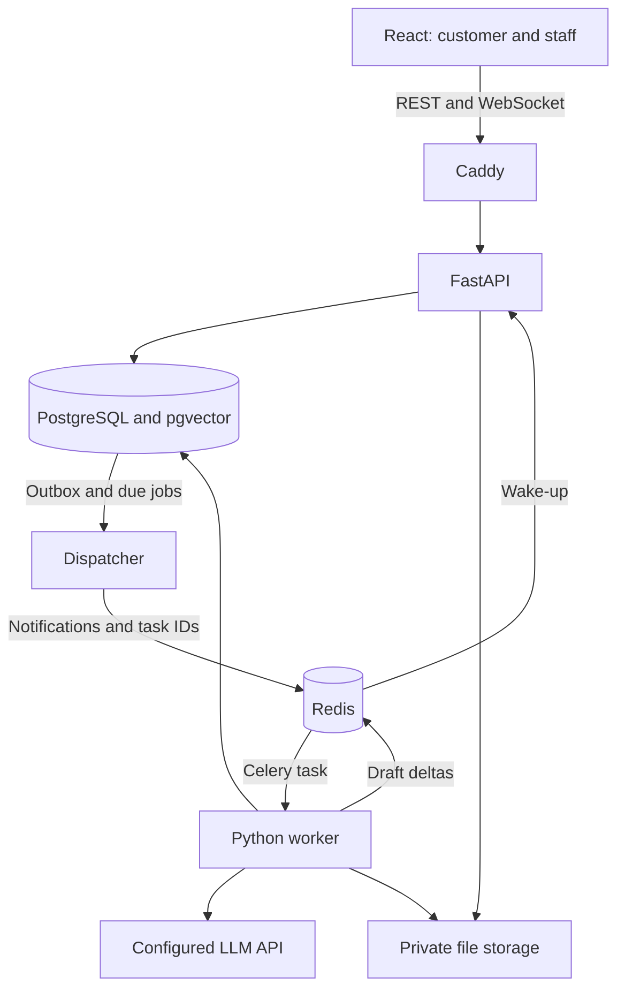
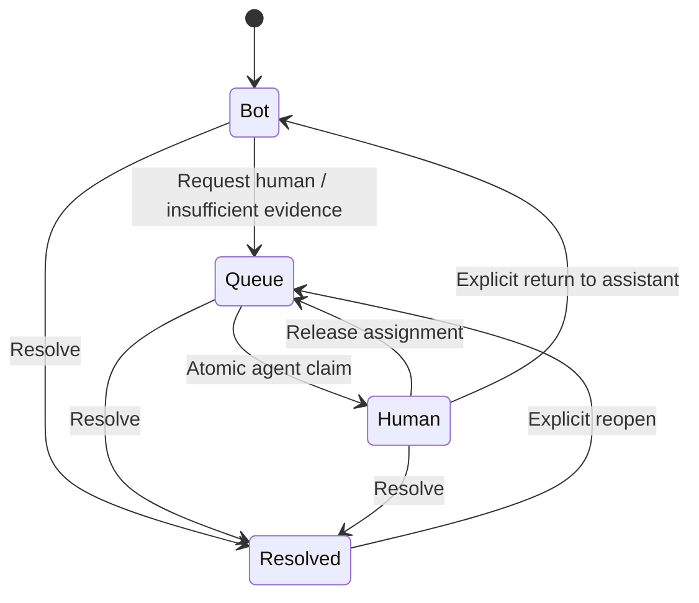
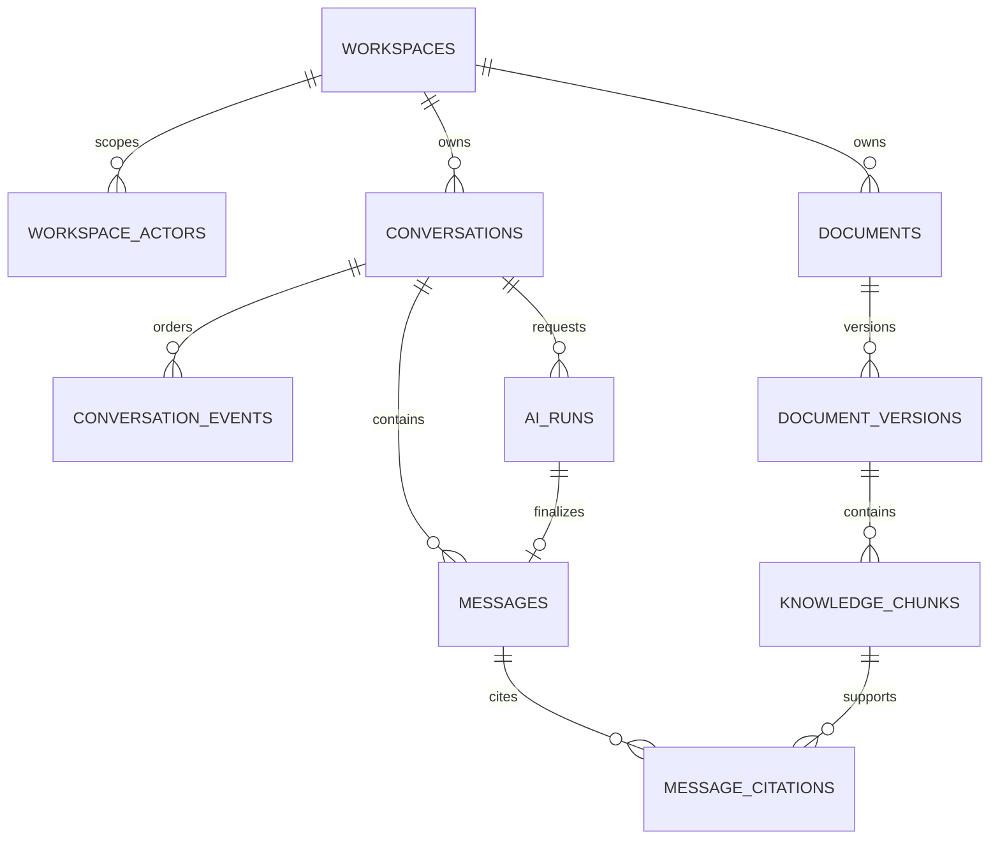
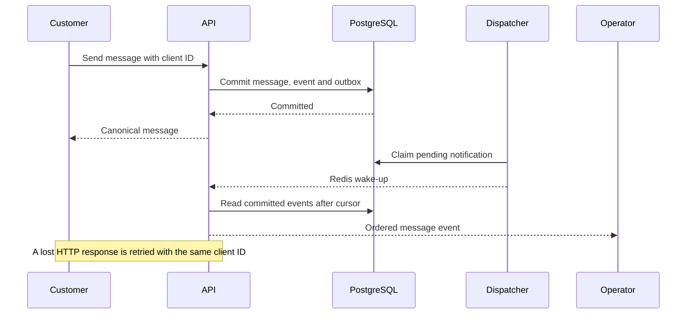

# SupportDesk — System Design and Implementation Blueprint

Version: 1.0  
Design date: 2026-10-26  
Owner: Armin Aboutalebi  
Status: implementation specification; performance targets and release gates are not measured results.

## 1. Product and scope

SupportDesk is a web support desk with persistent customer conversations, an operator inbox, answers grounded in approved documentation, and explicit transfer of control from AI to a human. The portfolio demonstration must let a reviewer experience both customer and operator views.

The product starts with one fictional business and five approved knowledge documents. The schema includes workspace boundaries from the first migration. Self-service SaaS provisioning and billing are later product features. Public demo sessions receive isolated demo workspaces so unrelated visitors do not share transcripts or operator permissions.

### Version 1

- Persian-first responsive UI with RTL support; English source code, comments, API identifiers, and technical documentation.
- Customer chat, operator inbox, assigned conversations, unread state, read receipts, and resolved conversations.
- Durable text messages, retry without duplicate creation, reconnect recovery, and a visible connection indicator.
- AI answers with provisional streaming, references to retrieved document passages, and explicit human handoff.
- Admin upload of Markdown, plain text, and text-based PDF documents; indexing status and document withdrawal.
- Login for staff; opaque visitor sessions for customers; admin and agent permissions within staff accounts.
- A reproducible local demo, production container images, CI, a small RAG evaluation set, and operational documentation.

### Later increments

Cross-domain embeddable widgets, email/WhatsApp channels, voice, general chat attachments, internal notes, automated external actions, billing, and large-scale multi-tenant provisioning are separate increments. Version 1 uses a same-origin chat page or same-origin widget. This avoids making third-party cookie behavior part of the initial authentication design.

## 2. Architecture decisions

| Decision | Selection | Reason |
|---|---|---|
| Repository | One monorepo | API, frontend, generated contracts, and deploy configuration evolve together |
| Backend organization | Modular monolith | Domain boundaries are explicit while transactions remain local |
| Runtime roles | API, dispatcher, worker | Web connections, reliable dispatch, and expensive work have different lifecycles |
| Business commands | REST | Commands have explicit responses, idempotency keys, authorization, and retry rules |
| Live delivery | Native WebSocket | One connection handles conversation events, typing, and AI drafts |
| Authoritative storage | PostgreSQL | Messages, ownership, events, jobs, and final AI results share transactional guarantees |
| Realtime transport | Redis Pub/Sub | Low-latency wake-ups; replay is supplied by PostgreSQL |
| Task execution | Celery with Redis broker | Established worker execution with application-level deduplication and fencing |
| Knowledge search | pgvector in PostgreSQL | Existing backup and access-control boundaries also cover document vectors |
| Frontend | One React SPA | Customer and staff routes share primitives and contracts |
| Deployment | Docker Compose on one Linux host | A concrete first deployment that can be operated and demonstrated |

API, dispatcher, and worker are processes built from the same Python package, not independently versioned microservices. A queue task contains an opaque job ID; it does not carry a customer transcript or authoritative business state.

Redis Pub/Sub does not replay missed messages [S2]. Consequently, a Redis notification is a hint to fetch committed state. HTTP success for a message means PostgreSQL committed it, not that another browser has already displayed it.



## 3. Selected stack

The versions below are compatibility baselines, not claims that every named major is the newest release. Exact package versions, image digests, and model revisions are pinned when the project is initialized and validated in CI. Floating `latest` image tags are not used for a release.

| Layer | Selection |
|---|---|
| Python runtime | Python 3.13, uv, `pyproject.toml`, `uv.lock` |
| HTTP and ASGI | FastAPI, Uvicorn, Pydantic 2, pydantic-settings |
| Persistence | SQLAlchemy 2.1, psycopg 3, Alembic |
| Database | PostgreSQL 17 with pgvector 0.8 family |
| Workers | Celery 5.6 family, Redis 8 family, JSON task serialization |
| LLM networking | HTTPX; a narrow provider adapter with configurable endpoint and model ID |
| Embeddings | Sentence Transformers, CPU PyTorch, `intfloat/multilingual-e5-small` |
| Document extraction | pypdf plus plain-text/Markdown parsers |
| Authentication | Opaque server sessions; pwdlib with Argon2id for staff passwords |
| Frontend runtime | Node.js 24 LTS, pnpm with a pinned `packageManager` |
| Frontend application | React 19, TypeScript strict mode, Vite |
| Routing and remote state | TanStack Router, TanStack Query |
| UI and forms | Tailwind CSS, Radix primitives, React Hook Form, Zod, i18next |
| HTTP client | Generated OpenAPI types, openapi-fetch |
| Realtime contracts | Pydantic-generated JSON Schema, generated TypeScript, Ajv validation |
| Backend quality | Ruff, mypy, pytest, HTTPX test client |
| Frontend quality | ESLint, Prettier, Vitest, Testing Library, Playwright |
| Operational visibility | JSON logs, Prometheus metrics; optional OpenTelemetry tracing profile |
| Proxy and deployment | Caddy, Docker Compose, GitHub Actions |

The embedding baseline produces 384-dimensional vectors and requires the documented `query: ` and `passage: ` prefixes [S7]. Persian retrieval quality must be evaluated on the project's own questions. A hosted chat model avoids requiring a local GPU. The specific paid/free endpoint and model ID remain deployment configuration: the architecture does not assume a free quota or provider availability in a particular country. A deterministic fake adapter supports offline development and CI; the UI explicitly identifies fixture mode.

No extra LLM orchestration framework is needed for the defined retrieve-and-answer flow. The provider boundary is `ChatProvider.stream(messages, limits)` and `Embedder.encode(texts)`. One backend implementation owns prompts, retrieval, usage accounting, and finalization.

## 4. Sizing assumptions and objectives

These are initial benchmark inputs and acceptance targets, not measured capacity or an availability guarantee.

| Item | Initial design envelope |
|---|---|
| Live connections | 200 simultaneous WebSockets, including multiple tabs |
| Human messages | 5 messages/second sustained, 20/second short burst |
| Stored messages | 10,000/day planning case |
| AI concurrency | One generation worker initially; two with a measured resource budget |
| Demo knowledge | Five documents; later up to 10,000 chunks per workspace before revisiting search indexes |
| Text message | 8,000 Unicode characters and 32 KiB UTF-8 maximum |
| Knowledge upload | 10 MiB/file, 50 PDF pages, 50,000 extracted tokens/file |
| Suggested benchmark host | 4 vCPU, 8 GiB RAM, SSD, no local chat-model GPU |
| Smaller development profile | One worker on 2 vCPU/4 GiB; measure embedding memory and latency |
| Message commit target | p95 below 300 ms, excluding internet latency, under the stated load |
| Healthy live delivery | p95 below 1 second after commit |
| Reconnect target | Replay up to 200 retained events in under 3 seconds |
| Missed-notification recovery | Periodic watermark checks every 15 seconds while the API/database are reachable |

At 10,000 messages/day and an assumed 2 KiB average body, raw bodies contribute approximately 20 MiB/day. Metadata, indexes, event payloads, WAL, and backups increase this. Measure actual database bytes rather than treating this estimate as a storage forecast.

LLM queue wait, time to first token, and complete-answer time are tracked separately. A 90-second request deadline is a failure boundary, not a latency promise. Provider performance is outside the human-chat latency objective.

## 5. Domain boundaries and dependency rules

| Module | Owns | Exposes |
|---|---|---|
| `identity` | Staff accounts, sessions, password verification | Resolve and revoke sessions |
| `workspaces` | Workspace actors, roles, demo isolation, settings | Authorized workspace context |
| `conversations` | Lifecycle, controller, assignment, epochs | Create, handoff, claim, release, resolve |
| `messaging` | Message persistence, idempotency, read cursors | Send message, history, receipts |
| `knowledge` | Artifacts, document versions, chunks, retrieval | Index, search, withdraw documents |
| `assistant` | AI runs, prompts, retrieval context, usage, citations | Plan run, stream draft, finalize result |
| `jobs` | Durable jobs, leases, dispatch and retries | Enqueue, claim, renew, finish, recover |
| `realtime` | Socket sessions, subscriptions, replay and ephemeral events | Deliver authorized event projections |
| `audit` | Staff/security-relevant changes | Append audit records |

Routes validate transport input and call application services. Services own transaction boundaries and policies. Repositories issue typed SQLAlchemy queries. Pure state transitions and policy decisions belong in `domain.py` or `policies.py`.

Modules call another module's explicit application interface, not its repository. Cross-module workflows use a shared unit of work where atomicity is necessary. Realtime handlers do not reproduce message or ownership rules. Business code does not import React, Celery decorators, or a particular LLM SDK.

API requests use one AsyncSession per request/task and short database transactions; a WebSocket does not hold an AsyncSession or connection for its lifetime. Concurrent asyncio tasks receive separate sessions [S6]. Celery tasks use a synchronous SQLAlchemy session/HTTPX client; shared domain functions remain independent of the transport. Each worker child initializes its own engine and model after fork.

## 6. Authentication and authorization

### Principal model

`staff_users` are global login identities. `workspace_actors` are scoped identities: `staff`, `visitor`, or `assistant`. A staff actor links a user to a workspace and carries `admin` or `agent`; a visitor actor represents one customer session identity. Each workspace has one assistant actor. Messages reference actors, eliminating unvalidated polymorphic sender IDs.

Separate staff and visitor cookies allow both demos in one browser:

- `__Host-sd_staff`: opaque staff session token, Secure, HttpOnly, SameSite=Lax, Path=/.
- `__Host-sd_visitor`: opaque visitor session token with the same protections.
- Staff routes accept only the staff session; customer routes accept only the visitor session.
- HTTP development uses explicitly configured non-`__Host-` names. Production refuses insecure session configuration.

Generate tokens using 256 bits of cryptographic randomness and store only their SHA-256 hashes. Rotate on login; revoke on logout. Sessions contain expiry and a synchronizer CSRF secret; authenticated bootstrap returns the CSRF value for `X-CSRF-Token`. State-changing browser requests require CSRF validation and exact allowed Origin. Session creation/login also require an allowed Origin and rate limits [S8].

Initial timeouts: staff absolute lifetime 12 hours with 30-minute idle expiry; visitor absolute lifetime 24 hours. Demo workspaces expire after 24 hours. Durable API operations verify active authorization at execution. Socket access is revalidated on subscription, durable delivery, and heartbeat, with a maximum 15-second idle revocation delay.

### Permissions

| Operation | Visitor | Agent | Admin |
|---|---|---|---|
| Read conversation | Own conversations | Workspace inbox and conversations | Workspace conversations |
| Send customer message | Own open conversation | No | No |
| Send staff message | No | Only when assigned | Claim/reassign first, then send |
| Request human | Own conversation | Yes | Yes |
| Claim queued conversation | No | Yes, atomically | Yes |
| Force reassign | No | No | Yes, with audit |
| Upload/withdraw knowledge | No | No | Yes |
| Configure AI/provider | No | No | Deployment/admin policy |

All domain queries use a server-resolved WorkspaceContext. Resource IDs and a public workspace key are identifiers, not access credentials. Composite workspace foreign keys prevent cross-workspace relationships. Cross-workspace tests are required even though the initial business demo is small.

The deployment database user has no superuser or migration privileges. Version 1 relies on scoped repositories, composite keys, and tests; it does not claim PostgreSQL row-level security is active. RLS can be added with transaction-local tenant context and dedicated tests before broad SaaS rollout.

## 7. Conversation state and human handoff

Keep lifecycle and controller separate:

- `status`: `open` or `resolved`.
- `controller`: `bot`, `queue`, or `human`.
- `assigned_actor_id`: non-null exactly when controller is `human`.
- `control_epoch`: increasing integer fencing obsolete AI work.
- `state_version`: optimistic version for control changes; independent of the event cursor.
- `last_event_seq`: last committed conversation event number.



Default creation is open/bot if AI is enabled and ready, otherwise open/queue. A resolved conversation does not accept messages until explicitly reopened. Reopening moves to the human queue. Operator disconnect does not automatically return a conversation to the bot.

Every claim/reassign/resolve request contains `expected_state_version`. Lock the conversation with `SELECT ... FOR UPDATE`, check the expected version and role, apply the change, increment state version and control epoch, append a durable event, cancel/supersede the current AI run, and create outbox notifications in one transaction. A competing claim gets `409 CONVERSATION_VERSION_CONFLICT`; it never silently replaces the first assignment. PostgreSQL row locks serialize these updates [S3].

Agents resolve, release, or return to bot only conversations assigned to themselves. Admins may resolve/reassign any conversation in their workspace. A visitor can request handoff from bot; repeating that request while queued/human returns the existing control state without removing a human assignment. Invalid transitions return `409 INVALID_TRANSITION`. Reopen clears any prior assignment and enters queue. Every successful control response includes the canonical controller, assignment, state version, and epoch.

A new visitor message while the controller is bot also increments `control_epoch`, supersedes an older pending run, and creates one run for the newest turn. The new run includes preceding committed customer messages in its context. This avoids separate overlapping answers to a rapid burst of customer messages.

### AI finalization fence

An AI run stores `expected_control_epoch`, `trigger_message_seq`, `prompt_version`, `provider_model`, and a job lease token. Immediately before publishing its final message, a transaction verifies:

1. Conversation is open and still controlled by bot.
2. Its control epoch matches the run.
3. The run remains the active run for this turn.
4. The worker still owns the unexpired job lease/fencing token.
5. Referenced document versions remain active and authorized.

If any check fails, the draft is discarded and the run becomes superseded/cancelled. If checks pass, one assistant message, citations, terminal run state, terminal job state, event, and outbox entry commit together. `UNIQUE(ai_run_id)` on final messages is the final duplicate-publication guard.

Handoff cancellation messages are a fast hint. The database fence is the correctness mechanism. Already transmitted draft bytes can be briefly visible until the client observes the new epoch; the client removes obsolete drafts. The hard guarantee is that an AI final message cannot commit after a successful handoff using the old epoch.

## 8. Data model

All business tables include `workspace_id` except global staff identities and staff sessions. IDs are UUIDv4; ordering uses explicit integer sequences, never UUID or wall-clock ordering. All timestamps are `timestamptz` in UTC. Text enums have database check constraints. Important relations use `(workspace_id, id)` foreign keys.

| Table | Important columns | Constraints / indexes |
|---|---|---|
| `workspaces` | id, public_key, name, ai_enabled, settings, expires_at | Unique public_key |
| `staff_users` | id, normalized_email, password_hash, active | Unique normalized_email |
| `workspace_actors` | id, workspace_id, kind, user_id, role, display_name, active | Unique workspace/user for staff; one assistant/workspace; kind/role checks |
| `sessions` | id, token_hash, staff_user_id, visitor_actor_id, csrf_secret, expires_at, last_seen_at, revoked_at | Exactly one owner type; unique token_hash; expiry index |
| `conversations` | id, workspace_id, visitor_actor_id, status, controller, assigned_actor_id, control_epoch, state_version, last_event_seq, updated_at | Assignment/controller check; workspace/status/controller/updated_at index |
| `messages` | id, workspace_id, conversation_id, sender_actor_id, client_message_id, body, body_hash, event_seq, ai_run_id, created_at | Unique conversation/event_seq; unique conversation/sender/client_message_id for client messages; unique non-null ai_run_id |
| `command_receipts` | id, workspace_id, actor_id, operation, key, request_hash, response, created_at | Unique workspace/actor/operation/key; retention index |
| `read_cursors` | workspace_id, conversation_id, actor_id, last_read_seq, updated_at | Unique conversation/actor; monotonic updates bounded by current event seq |
| `conversation_events` | id, workspace_id, conversation_id, seq, type, schema_version, payload, created_at | Unique conversation/seq; conversation/seq replay index |
| `outbox` | id, workspace_id, kind, reference_id, dedupe_key, status, available_at, lease_token, leased_until, attempts, published_at | Unique dedupe_key; due/unpublished partial index |
| `jobs` | id, workspace_id, kind, resource_id, status, attempt, available_at, lease_token, leased_until, dispatch_generation, last_dispatched_at, error_code | Unique logical job key; due/status index |
| `ai_runs` | id, workspace_id, conversation_id, trigger_message_seq, expected_control_epoch, status, prompt_version, provider_model, output_message_id, timing, usage | Unique conversation/epoch; active run index |
| `ai_attempts` | id, workspace_id, run_id, attempt, provider_request_id, input_tokens, output_tokens, usage_state, started_at, finished_at | Unique run/attempt; unknown provider usage remains explicit |
| `artifacts` | id, workspace_id, storage_key, sha256, content_type, bytes, state | Unique storage_key; orphan cleanup index |
| `documents` | id, workspace_id, title, active_version_id, withdrawn_at | Workspace/active index |
| `document_versions` | id, workspace_id, document_id, artifact_id, version_no, status, parser_version, embedding_model, embedding_revision, content_hash | Unique document/version_no |
| `knowledge_chunks` | id, workspace_id, version_id, ordinal, text, page_start, page_end, heading_path, token_count, embedding vector(384) | Unique version/ordinal; workspace/version index |
| `run_sources` | workspace_id, run_id, chunk_id, source_label, rank, score | Unique run/source_label; immutable selected-source mapping |
| `message_citations` | workspace_id, message_id, source_label, version_id, chunk_id, excerpt, locator | Unique message/source_label |
| `usage_reservations` | id, workspace_id, ai_run_id, period, reserved_tokens, actual_tokens, state | Unique run; workspace/period accounting index |
| `rate_limit_buckets` | bucket_hash, action, window_start, count, expires_at | Unique bucket/action/window; atomic conditional upsert |
| `audit_log` | id, workspace_id, actor_id, action, subject_id, request_id, metadata, created_at | Workspace/time index; excludes raw tokens and passwords |

`workspace_actors` represents both staff membership and customer identity; no separate visitors or membership table is required. Visitor actors cannot reference a staff user. Staff actors must have one. Application policies verify actor kinds on assignment and message authorship in addition to the workspace foreign keys.

`conversation_events` contains only customer-safe conversation facts. Staff-only operational metadata belongs in audit records. This keeps the same event sequence usable by customers and staff without leaking internal content or creating unexplained permission-filtered cursor gaps. Internal notes require a separately designed audience stream in a later version.



The ER diagram is a relationship summary; the table above is authoritative for supporting tables. Do not implement cascading deletes that silently remove audit evidence or message history when a staff account is deactivated.

## 9. Message persistence, idempotency, and ordering

The browser creates a `client_message_id` UUID for each deliberate send. It keeps that ID through timeout, refresh, and retry. A new deliberate send gets a new ID even when its text is identical. A small IndexedDB pending-send store is scoped to the current actor and workspace and cleared on logout/expiry; it contains no authentication token. After reload, unresolved sends are reconciled before asking the user to retry.

### Send transaction

1. Resolve the authenticated actor and authorize conversation access.
2. Validate body size and normalize only the API-defined representation, preserving original user text.
3. Lock the conversation row.
4. Look up an existing message with the same conversation, actor, and client ID. Compare its body hash. If identical, return it without a new side effect; if different, return `409 IDEMPOTENCY_CONFLICT`.
5. Only for a new message, verify conversation/controller permissions and rate limits. Existing authorized retries remain recoverable after a conversation is resolved.
6. Increment `last_event_seq`; insert the message and `message.created` event at that sequence.
7. For an eligible customer turn, supersede the older AI run, reserve permitted usage, and insert the new run, job, and dispatch outbox record. If AI admission is unavailable, store the message and move to queue instead of rejecting the human message.
8. Insert the realtime outbox record and commit.
9. Return the canonical message and current conversation state. Replayed requests return the original message with the current state; only the original message identity/body are immutable.

Use `201` for a newly committed message and `200` for a replay. A timeout does not imply failure; the same client ID is safe to retry. A unique constraint backs the application check. Commit order under the conversation lock establishes sequence order; timestamp ordering is not a substitute.



For control commands, use an `Idempotency-Key` plus a stored request/result record or equivalent command ledger, scoped to workspace, actor, operation, and key. Add `command_receipts(id, workspace_id, actor_id, operation, key, request_hash, response, created_at)` with a unique scope key. Retain receipts for at least 30 days; an expired key is no longer a replay guarantee. Verify authorization before returning a prior receipt. Check a replay before expected-state-version validation so a lost successful response can be recovered.

## 10. WebSocket protocol and reconnect

Customer: `/api/v1/realtime/customer`. Staff: `/api/v1/realtime/staff?workspace_id=<uuid>`. The query contains a scope identifier, never a session token. The server validates cookies and an exact Origin allowlist before accepting the connection. Unknown event types and unsupported protocol versions are rejected.

The socket accepts only subscribe/unsubscribe, ping/pong, and throttled typing hints. All durable mutations, including read cursors, use REST. A single per-connection sender task serializes writes; producers enqueue frames rather than calling send concurrently.

Durable envelope:

```json
{
  "protocol_version": 1,
  "type": "message.created",
  "event_id": "3ed780fe-e95a-49b9-b497-fdb8dc30a123",
  "conversation_id": "3a536ef2-1427-4fd8-a776-242936e0caff",
  "seq": 42,
  "occurred_at": "2026-10-26T15:30:00Z",
  "data": {
    "message_id": "482e8dcf-153f-4b3e-9c58-2c72840f676f",
    "client_message_id": "bfbe7370-3110-4636-8de4-c452edb3e363",
    "sender_kind": "visitor",
    "body": "How do I configure a webhook?"
  }
}
```

| Durable events | Ephemeral events |
|---|---|
| `conversation.created` | `typing.updated` |
| `message.created` | `presence.updated` |
| `conversation.control_changed` | `ai.delta` |
| `conversation.resolved` / `conversation.reopened` | `inbox.invalidated` |
| `read_cursor.updated` | `ping` / `pong` |
| `ai.run_changed` | Connection/subscription protocol responses |

Presence is per connection with a short Redis TTL, aggregated to actor presence. Typing expires after 5 seconds and is throttled to at most one update/second. Presence never grants or revokes ownership. Read cursors advance with `GREATEST(old, supplied)` and are checked against the conversation watermark. The UI only reports a customer's message as read when an authorized staff cursor passed it; a saved message is not automatically read.

A supplied read cursor must refer to a visible message sequence, not merely the latest control/receipt event. Applying a receipt event must not generate another receipt. This keeps read state monotonic without creating an acknowledgement loop.

### Reconnect algorithm

1. Initial REST snapshot returns conversation state, recent messages, active run state, and event cursor H from a consistent database snapshot.
2. Client subscribes with its last applied cursor. Server registers the live wake-up handler before starting replay.
3. Server obtains high watermark H2 and reads events `(cursor, H2]` in ordered pages. New wake-ups are coalesced to a highest pending sequence while replay proceeds.
4. After replay, drain all events after the replay cursor from the database; then continue normal delivery. Each notification triggers a query from the last sent cursor, not direct forwarding of potentially out-of-order payloads.
5. Client deduplicates by event ID/sequence and advances its cursor only after applying an event. An apparent gap triggers replay.
6. Every 15 seconds, the API batches watermark checks for subscribed conversations. This repairs a missed final notification even if no subsequent message arrives. Inbox queries also refresh on reconnect and periodically.
7. If the cursor predates retained events, return `RESET_REQUIRED`. Fetch a fresh snapshot and replace canonical cache state; older history remains paginated separately.

Reconnect uses exponential backoff with jitter, capped at 15 seconds, and immediate retry on browser online events. Apply at most 100 events per replay page. Bound each socket's send buffer to 256 frames or 1 MiB; coalesce typing/deltas first, and disconnect a persistently slow client with a resumable reason instead of allowing unbounded memory growth.

AI deltas include `run_id`, `control_epoch`, `attempt`, and `chunk_index`. They are provisional, non-replayable text. On a gap, attempt change, or reconnect, discard that partial draft and show generation status until the committed final message arrives. Final text always comes from `message.created`/history. No character-by-character persistence is required.

## 11. Outbox, jobs, leases, and crash recovery

The dispatcher is a small supervised Python process in the same codebase. It polls due outbox rows every 250 ms when busy and backs off when idle. Claim rows in a short transaction using `FOR UPDATE SKIP LOCKED`, record a random lease token and expiry, commit, publish outside the transaction, then mark published only if that token still owns the row. Never hold a database transaction open during a Redis or provider call.

Outbox kinds:

- `conversation.notify`: publish workspace/conversation IDs and a watermark; consumers fetch canonical events.
- `job.dispatch`: submit `execute_job(job_id)` to Celery; the durable job is already in PostgreSQL.

If the dispatcher crashes after publish but before marking published, the record can be published again. Clients and workers must handle duplicates. A Celery `task_id` by itself does not deduplicate execution.

### Job execution protocol

1. Worker atomically claims a due pending/retry job or an eligible expired lease. Terminal jobs and jobs with a valid lease are no-ops.
2. Claim increments `attempt` and issues a new random `lease_token`; default lease is 60 seconds, renewed every 15 seconds.
3. A heartbeat uses its own database session. Loss of lease means the attempt must stop committing results and stop producing useful drafts.
4. Expensive extraction, embedding, retrieval, and LLM requests run outside database transactions.
5. Finalization uses the current job token plus domain fences. Persist domain output and terminal job state atomically.
6. Classify failures. Unsupported documents and invalid provider configuration are terminal. Transient network failures and rate limits can be retried within a bounded budget.

The dispatcher also runs a reconciliation scan every 15 seconds. It recovers expired running leases, due retry jobs, and pending jobs that have not been claimed within 120 seconds of dispatch. It creates a new dispatch generation/outbox record transactionally. A lost Redis queue can therefore be reconstructed from PostgreSQL. Redis persistence helps availability but is not the authoritative job ledger.

Use at most three application execution attempts. Suggested retry delays are 5 and 20 seconds with jitter; honor a bounded Retry-After when appropriate. A manual retry creates an audited new attempt budget after the cause is addressed. Superseded AI runs are cancelled, never retried. Reconciliation does not resurrect withdrawn documents or expired demo workspaces.

Recommended Celery settings [S4, S5]:

| Setting | Baseline |
|---|---|
| `task_serializer` / `accept_content` | JSON only |
| `task_ignore_result` | true; results live in PostgreSQL |
| `task_acks_late` | true for these idempotent tasks |
| `task_reject_on_worker_lost` | true, paired with bounded DB attempt budgets |
| `worker_prefetch_multiplier` | 1 |
| Broker visibility timeout | 900 seconds, longer than all configured task hard limits |
| AI task time limits | Soft 110 s, hard 120 s; provider total deadline 90 s |
| Ingestion time limits | Soft 270 s, hard 300 s |
| Initial worker concurrency | 1 |

Celery autoretry is disabled for business retries; the PostgreSQL job scheduler owns that policy. This avoids multiplying two independent retry loops. LLM calls may still be repeated after an ambiguous provider timeout, so provider billing is not exactly-once. Record usage per attempt when available; mark uncertain usage instead of inventing a zero-cost result.

Two queues, `ai` and `ingestion`, use the same application. One worker can consume both locally; the production profile can dedicate one worker to each to avoid a large document delaying a customer answer.

### Lock order

For AI finalization, acquire source-document locks in sorted ID order, then the conversation, then any workspace usage lock, then run/job rows. Chat mutations start at the conversation and follow the same suffix. Ingestion only locks document/version rows; job claim transactions finish before domain work starts. Source withdrawal never acquires conversation locks. Retry transient deadlocks at the transaction boundary with the same idempotency identity.

## 12. RAG and knowledge lifecycle

### Ingestion

1. An admin uploads a bounded file. API checks extension/content type, streams it to a random private storage key, computes SHA-256, then records an artifact, pending document version, job, and outbox entry.
2. A crash before the database commit may leave an orphan file; a cleanup job removes unreferenced files after a grace period. A database record never points to a partially written final file: finalize the local temporary file atomically before commit.
3. Worker extracts text with pypdf or a bounded text parser. Scanned PDFs with insufficient extracted text receive `OCR_REQUIRED`; OCR is a future capability.
4. Preserve original text, document title, page number, section heading, and chunk ordinal. Normalize a separate search representation for Arabic/Persian character variants and spacing.
5. Split by headings/paragraphs into approximately 350 embedding-model tokens, with up to 50 tokens overlap; enforce the model's 512-token limit after adding prefixes [S7].
6. Embed with a pinned model revision. Store `vector(384)`, model ID, revision, parser version, and source hash.
7. Atomically activate the completed version. The prior active version stays available until the new version is fully ready. Partially indexed chunks are never retrieved.

Version state: `pending -> processing -> ready`, with terminal `failed` or `withdrawn`. Document replacement creates a new immutable version; it does not mutate passages already cited by a message. Changing embedding models/dimensions requires a new index generation and complete reindex before activation.

### Retrieval and generation

The worker checks the run fence, embeds the query, and retrieves only active public knowledge in the resolved workspace. Version 1 starts with exact cosine search in pgvector and tenant/version filters; this is sufficient for the defined small corpus and avoids approximate-index filtering surprises. Add HNSW only after measuring corpus size, query time, and recall [S9].

Retrieve up to eight candidates and include at most four passages within a 2,000-token context budget. Pass recent committed conversation messages under a separate 2,000-token history budget. The provider adapter enforces the complete prompt/output limit for the configured model; truncate whole historical turns rather than arbitrary text. Initial maximum output is 800 provider tokens. Long-term memory and automatic conversation summarization are later increments.

Store `run_sources` before generation. Source labels such as `S1` map to immutable chunk/version IDs. The model may emit only those labels; the server creates titles, locators, and links from stored metadata. It never trusts a model-generated document URL.

The prompt treats customer messages and document text as data. Version 1 has no model-controlled external actions. For knowledge answers, require structurally valid citations; a missing/invalid source reference or a defined no-answer marker prevents final publication and routes the conversation to the queue. Empty or unsuitable retrieval can hand off before calling the model. Retrieval thresholds are tuned using evaluation examples; a raw cosine value is not a calibrated probability.

Streamed text is labelled as an in-progress draft. It may be discarded if final citation validation or ownership checks fail. Structural source validation does not prove every statement is supported: answer faithfulness is measured with a human reference set and reviewed examples.

Immediately before finalization, lock the referenced document rows with a mode that prevents concurrent withdrawal and recheck access/active versions. If a source was replaced or withdrawn during generation, discard the run and hand off with `KNOWLEDGE_CHANGED`; a later customer turn can use the new knowledge. Do not silently finalize using a superseded source set.

Withdrawing a document immediately excludes it from new retrieval. Old transcript text remains subject to transcript retention; it is not retroactively rewritten. Citation navigation to a withdrawn source displays that the source is unavailable. A retention job later purges withdrawn artifacts/chunks as appropriate while retaining necessary historical citation metadata.

### Provider and usage policy

- Required live configuration: endpoint, provider adapter, model ID, secret API key, context limit, and timeout policy.
- Reference adapter: a configurable Chat Completions-compatible HTTP streaming interface implemented with HTTPX; provider quirks stay inside the adapter.
- Fake adapter: deterministic answer/delta/error scripts for development and automated tests; never presented as a live model.
- Provision embeddings/model files before startup and cache the pinned revision; no implicit weight download in the API request path.
- Reserve the configured maximum input/output token allowance before scheduling a run, under a workspace-period budget lock. Reconcile against actual provider usage after completion.
- The initial reservation covers all three permitted attempts, and `ai_attempts` records each call separately. Release only the unused, known portion at termination. Ambiguous provider usage remains charged at the reserved per-attempt maximum until reconciled; reservation expiry alone never converts uncertain usage to zero.
- Account for failed and superseded attempts when usage is reported. Expiry releases reservations for work that never started; it does not erase the uncertain usage of an external call.
- Enforce daily token caps and maximum queued/active AI runs. If budget or provider admission fails, human chat continues and the conversation joins the queue.
- No automatic switch to a more expensive model. Provider changes are an explicit configuration/version change recorded on each run.

### Evaluation gate

Maintain 40 versioned cases: 20 answerable questions, 10 missing-knowledge questions, five workspace/source-isolation cases, and five instruction-injection cases. Cover Persian and English, paraphrases, misspellings, and mixed technical terminology. Label expected supporting passages and whether handoff is appropriate.

Report retrieval recall@5, source-ID validity, human-rated support of claims, correct handoff rate, p50/p95 first-token and full-answer latency, and provider-reported tokens. Require zero source-isolation failures and zero old-epoch final commits in the test set. Tune quality thresholds on a development subset and evaluate on held-out cases. A small sample does not establish production accuracy.

## 13. REST API inventory

All URLs start with `/api/v1`. Define `C = /customer` and `S = /staff/workspaces/{workspace_id}`. Shared schemas/application services sit behind separate customer/staff routers. Resolve identity from the corresponding session cookie, never from a body-supplied author ID.

| Method | Path | Behavior |
|---|---|---|
| POST | `/auth/staff/login` | Rotate/create staff session |
| GET | `/auth/staff/me` | Staff identity, memberships, CSRF bootstrap |
| POST | `/auth/staff/logout` | Revoke session and disconnect its sockets |
| POST | `/public/workspaces/{public_key}/visitor-sessions` | Rate-limited visitor session bootstrap |
| GET | `/customer/session` | Visitor identity, expiry, CSRF bootstrap |
| POST | `/customer/logout` | Revoke visitor session |
| POST | `C/conversations` | Create conversation with idempotency key |
| GET | `C/conversations` | Own conversations, cursor pagination |
| GET | `S/conversations` | Inbox filtered by controller/status/assignee |
| GET | `{C or S}/conversations/{id}/snapshot` | Consistent state, recent messages, event cursor |
| GET | `{C or S}/conversations/{id}/messages` | History before an opaque cursor; default 50, max 100 |
| POST | `{C or S}/conversations/{id}/messages` | Idempotent send using client message ID |
| GET | `{C or S}/conversations/{id}/events` | Authorized durable replay after sequence; max 100/page |
| PUT | `{C or S}/conversations/{id}/read-cursor` | Monotonic last visibly read message sequence |
| POST | `{C or S}/conversations/{id}/handoff` | Move bot-controlled conversation to queue |
| POST | `S/conversations/{id}/claim` | Versioned atomic claim |
| POST | `S/conversations/{id}/release` | Assigned agent releases to queue |
| POST | `S/conversations/{id}/reassign` | Admin reassignment with audit |
| POST | `S/conversations/{id}/return-to-bot` | Explicitly change controller; future customer turn starts AI |
| POST | `S/conversations/{id}/resolve` | Resolve and invalidate active AI |
| POST | `{C or S}/conversations/{id}/reopen` | Explicitly reopen into queue |
| GET | `{C or S}/conversations/{id}/ai-runs/{run_id}` | Safe progress/status projection |
| GET | `{C or S}/conversations/{id}/citations/{message_id}/{label}` | Authorized source excerpt/locator |
| GET | `S/knowledge/documents` | Admin document list and indexing state |
| POST | `S/knowledge/documents` | Admin upload; returns document and job IDs, HTTP 202 |
| POST | `S/knowledge/documents/{id}/versions` | Admin replacement upload |
| DELETE | `S/knowledge/documents/{id}` | Withdraw; purge scheduled separately |
| GET | `S/jobs/{id}` | Admin-safe job status |
| POST | `S/jobs/{id}/retry` | Audited bounded retry |
| GET | `/health/live` | Process liveness |
| GET | `/health/ready` | Database/schema readiness and dependency state |

Control POSTs use `Idempotency-Key` and `expected_state_version`. A human staff message may include the viewed state version; assignment/controller permission is always checked under the conversation lock. Read-cursor PUTs are naturally idempotent. Upload retries use a command identity and server-computed content hash so a network retry does not create a second version.

Human-message request:

```json
{
  "client_message_id": "bfbe7370-3110-4636-8de4-c452edb3e363",
  "body": "How do I configure a webhook?"
}
```

Claim request:

```json
{
  "expected_state_version": 7
}
```

Use a uniform `application/problem+json` error envelope. The frontend localizes stable codes:

```json
{
  "type": "about:blank",
  "title": "Conversation state changed",
  "status": 409,
  "code": "CONVERSATION_VERSION_CONFLICT",
  "request_id": "22fd22d0-03b2-46f4-9105-5c0e0f2b2ac7",
  "details": {
    "current_state_version": 8
  }
}
```

Other stable codes include `AUTH_REQUIRED`, `SESSION_EXPIRED`, `RESOURCE_NOT_FOUND`, `CONVERSATION_RESOLVED`, `NOT_ASSIGNED`, `INVALID_TRANSITION`, `IDEMPOTENCY_CONFLICT`, `RATE_LIMITED`, `RESET_REQUIRED`, `FILE_TOO_LARGE`, `OCR_REQUIRED`, and `KNOWLEDGE_CHANGED`. Do not expose another tenant's resource existence in an authorization error. A 429 response includes Retry-After. A provider outage is an AI-run/handoff state, not an invented successful assistant message.

Initial admission limits: 20 new messages/minute/actor, five session creations/minute/IP, five failed staff logins/minute/account+IP, and ten uploads/hour/workspace. Use atomic PostgreSQL rate-limit buckets for these low-volume durable commands so a Redis outage does not disable existing human chat. Store a keyed hash of IP identifiers with short expiry. Infrastructure also caps connections and request bodies; typing is throttled in each socket process. Replays of an already persisted message do not consume another message quota. Tune limits using demo/load-test evidence.

## 14. Frontend structure and behavior

Routes:

- `/demo`: create/enter an isolated demonstration with explicit fixture/live mode.
- `/chat/$publicKey`: customer conversation experience.
- `/login`: staff login.
- `/app/$workspaceId/inbox`: queue, assigned conversations, and resolved filter.
- `/app/$workspaceId/conversations/$conversationId`: message pane, controller, assignment, references.
- `/app/$workspaceId/knowledge`: admin document upload, indexing state, and withdrawal.
- `/app/$workspaceId/settings`: limited workspace settings.

TanStack Query owns canonical API state [S11]. Query keys always include audience, workspace, and resource ID. A small realtime manager owns connection/subscription lifecycle. React context/reducers hold only local UI state and transient AI drafts; do not duplicate the full server message cache in a second global store.

The message list merges optimistic sends by `client_message_id`. HTTP responses and socket events can arrive in either order. Both reconcile to the same server message ID. Clear all scope-specific caches and pending sends on logout or workspace change.

Render Markdown with raw HTML disabled, safe link protocols, and controlled components. User text and AI text are never injected as arbitrary HTML. Citation navigation uses the API's authorized source route. Provisional AI output has a distinct pending treatment and becomes a normal message only after commit.

Preserve scroll position when older messages load. Auto-scroll only when the reader is already at the bottom; otherwise show a new-message indicator. Put keyboard focus on the composer after intentional navigation, not on every incoming message. Use polite live regions for message status and avoid announcing every streamed token.

Use `dir="rtl"` at the Persian application boundary, `dir="auto"` for message bodies, and LTR code blocks/technical identifiers. UI copy is centralized in `locales/fa.json`; retain `en.json` for an optional English interface. Dates render in the selected locale/timezone while API values remain UTC.

When the socket is unavailable, keep REST sends enabled if the API is reachable, show the degraded connection state, and poll active conversation snapshots/events. A queued AI response displays queue status rather than a fake typing animation that implies generation has started.

## 15. Repository and folder layout

Repository name: `supportdesk`. This tree specifies the intended implementation. It is not a claim that application files have already been created.

```text
supportdesk/
  README.md
  AGENTS.md
  LICENSE
  .env.example
  .python-version
  .node-version
  .gitignore
  .dockerignore
  package.json
  pnpm-workspace.yaml
  pnpm-lock.yaml
  compose.yaml
  compose.dev.yaml
  apps/
    backend/
      pyproject.toml
      uv.lock
      alembic.ini
      Dockerfile
      migrations/
        env.py
        versions/
      src/supportdesk/
        main.py
        bootstrap.py
        config.py
        api/
          router.py
          dependencies.py
          errors.py
          middleware.py
          health.py
        infrastructure/
          database.py
          unit_of_work.py
          redis.py
          storage.py
          http.py
          logging.py
          metrics.py
        modules/
          identity/
            models.py
            schemas.py
            repository.py
            service.py
            routes.py
          workspaces/
          conversations/
            domain.py
            policies.py
            models.py
            schemas.py
            repository.py
            service.py
            customer_routes.py
            staff_routes.py
          messaging/
          knowledge/
            models.py
            schemas.py
            repository.py
            service.py
            ingestion.py
            retrieval.py
            chunking.py
            parsers.py
            routes.py
          assistant/
            models.py
            schemas.py
            service.py
            generation.py
            finalization.py
            citations.py
            budgets.py
            providers/
              base.py
              compatible_http.py
              fake.py
            embeddings/
              base.py
              e5.py
            prompts/
              answer_v1.txt
          jobs/
            models.py
            repository.py
            service.py
            leases.py
            outbox.py
            recovery.py
          realtime/
            protocol.py
            customer_endpoint.py
            staff_endpoint.py
            connection.py
            subscriptions.py
            replay.py
            projections.py
          audit/
        workers/
          celery_app.py
          tasks.py
          dispatcher.py
        cli/
          seed_demo.py
          create_staff.py
          export_contracts.py
          evaluate_rag.py
          purge_expired.py
      tests/
        conftest.py
        unit/
        integration/
        contracts/
        reliability/
    web/
      package.json
      tsconfig.json
      vite.config.ts
      index.html
      public/
      src/
        app/
          router.tsx
          providers.tsx
          query-client.ts
        routes/
        features/
          auth/
          customer-chat/
          inbox/
          conversation/
          knowledge/
          workspace-settings/
        components/
          ui/
          layout/
        lib/
          api.ts
          realtime/
            client.ts
            replay.ts
            event-reducer.ts
            draft-streams.ts
          pending-sends.ts
          markdown.tsx
        locales/
          fa.json
          en.json
        styles/
        test/
      e2e/
  packages/
    api-client/
      package.json
      src/
        generated/
          http.d.ts
          realtime.d.ts
          realtime.schema.json
        client.ts
        index.ts
  contracts/
    openapi.json
    realtime.schema.json
    examples/
  evals/
    rag/
      cases.jsonl
      rubric.md
      fixtures/
      reports/
  fixtures/
    knowledge/
    conversations/
  deploy/
    Caddyfile
    compose.production.yaml
    postgres/
    observability/
    backup/
  scripts/
    export-contracts.sh
    check-contracts.sh
    smoke.sh
    benchmark-realtime.js
  docs/
    system-design.md
    api.md
    realtime-protocol.md
    data-model.md
    threat-model.md
    runbook.md
    evaluation.md
    adrs/
  .github/
    workflows/
      ci.yml
      release.yml
```

Feature folders contain their UI, hooks, queries, and local types. Shared UI lives in `components/ui`; there is no separate design-system package until a second consumer exists. Backend modules use the small identity/conversations layout as a pattern; create additional files only when they contain a responsibility.

`main.py` creates the FastAPI application. `bootstrap.py` wires dependency implementations. `workers/tasks.py` wraps application operations with Celery; business logic stays in modules. `infrastructure/` contains adapters, not cross-domain business helpers. Avoid a growing miscellaneous `utils.py`.

Pydantic models are the contract source of truth. Export OpenAPI and the realtime discriminated-union JSON Schema, then generate TypeScript. CI regenerates and fails on uncommitted differences. Developers change source schemas rather than hand-editing generated output. Breaking realtime changes increment `protocol_version`; additive optional fields remain compatible.

### Intended development commands

These commands define interfaces to implement with the scaffold; they are not commands that can run against this design document alone.

| Working directory | Command | Purpose |
|---|---|---|
| Repository root | `docker compose -f compose.yaml -f compose.dev.yaml up -d postgres redis` | Start local dependencies |
| `apps/backend` | `uv sync --locked --all-extras` | Install locked runtime/worker/development dependencies |
| `apps/backend` | `uv run alembic upgrade head` | Apply database migrations |
| `apps/backend` | `uv run python -m supportdesk.cli.seed_demo` | Create explicit fictional fixtures |
| `apps/backend` | `uv run uvicorn supportdesk.main:create_app --factory --reload` | Start development API |
| `apps/backend` | `uv run python -m supportdesk.workers.dispatcher` | Start dispatch/recovery loop |
| `apps/backend` | `uv run celery -A supportdesk.workers.celery_app:app worker -Q ai,ingestion --concurrency=1` | Start local worker |
| Repository root | `pnpm install --frozen-lockfile` | Install locked frontend dependencies |
| Repository root | `pnpm --filter @supportdesk/web dev` | Start Vite with same-origin API/WS proxy |
| Repository root | `pnpm contracts:check` | Regenerate contracts and detect drift |

Expose optional Python dependency groups/extras for worker inference and development tools. The development Vite proxy forwards `/api` including WebSocket upgrades so browser authentication uses one origin. Use the gateway's port 8080 for the complete container demo; configure the Vite origin explicitly when using its development server.

## 16. Deployment and runtime configuration

### Compose services

| Service | Responsibility | Initial replicas |
|---|---|---|
| `gateway` | Caddy, TLS, SPA assets, API/WS proxy | 1 |
| `api` | FastAPI/Uvicorn; one process per container | 1; test with 2 |
| `dispatcher` | Outbox delivery and job recovery | 1 |
| `worker` | Celery AI and ingestion tasks | 1 |
| `postgres` | Durable database and vectors | 1 |
| `redis` | Broker, notifications, presence | 1 |
| `migrate` | One-shot Alembic migration | Deployment job |

An optional profile adds a dedicated ingestion worker, Prometheus/Grafana, and tracing. Expose only gateway ports. PostgreSQL and Redis remain on a private container network. Local file storage is a persistent volume mounted into API and worker; API serves artifacts only through authorized endpoints. When moving workers to another host, replace the file-storage adapter with an S3-compatible service before scaling them.

Build two targets from the backend Dockerfile: a light runtime for API/dispatcher and a worker runtime with document/embedding dependencies. Both share the same application revision and lockfile. Download pinned embedding weights during image preparation or an explicit initialization step. Images run as non-root with writable paths restricted to explicit volumes/temp storage.

Use Redis AOF and `noeviction` for the first combined instance. Prefix all keys/channels. A separate cache/realtime Redis may be introduced when load requires it; Redis database numbers do not provide Pub/Sub channel isolation [S2].

Run migrations once before starting a new release; API startup checks schema compatibility rather than having every replica run migrations. Expand/contract migrations keep rolling deployments compatible. On shutdown the API stops accepting new connections, closes sockets with a reconnect reason, and finishes short requests. Worker shutdown drains or lets leases expire; fenced results prevent stale commits.

### Configuration groups

```dotenv
APP_ENV=development
PUBLIC_BASE_URL=http://localhost:8080
DATABASE_URL=
REDIS_URL=
SESSION_SECRET=
ALLOWED_ORIGINS=http://localhost:8080
STORAGE_BACKEND=local
STORAGE_ROOT=/var/lib/supportdesk/files
LLM_PROVIDER=fake
LLM_BASE_URL=
LLM_MODEL=
LLM_API_KEY=
LLM_CONTEXT_LIMIT=
EMBEDDING_MODEL=intfloat/multilingual-e5-small
EMBEDDING_REVISION=
AI_MAX_OUTPUT_TOKENS=800
AI_TOTAL_TIMEOUT_SECONDS=90
AI_DAILY_TOKEN_LIMIT=100000
DEMO_MODE=true
```

These are configuration keys and illustrative development defaults, not credentials or an already working environment file. Pydantic settings validate required fields, URL schemes, production cookie rules, numeric limits, and mutually incompatible modes. Pin a real embedding revision during bootstrap. Never fall back to fake answers silently when a live provider fails.

### Health and degradation

`/health/live` checks process health without a database dependency. `/health/ready` requires a reachable database and compatible schema. Redis/provider failures are reported as degraded dependencies while human REST chat remains available; removing every API instance from service would unnecessarily disable the fallback. Proxy/WebSocket idle timeouts exceed heartbeat intervals.

The API's in-memory connection registry is local to that process. All instances subscribe to notifications and perform authorized DB replay for their own sockets. FastAPI's in-memory tutorial example alone is not a multi-process distribution layer [S1].

## 17. Observability, operations, and retention

Every request and job has a request/trace ID. Structured logs include workspace, conversation, run, job, and attempt identifiers where appropriate. Routine logs exclude message bodies, document text, session cookies, prompts, and API keys.

| Signal | Purpose |
|---|---|
| HTTP latency/error rate by route template | Detect slow or failing business operations |
| Open sockets, reconnects, buffer overflows | Detect realtime delivery issues |
| Durable event lag and replay count | Distinguish transport trouble from missing data |
| Oldest pending outbox age | Detect dispatcher failure |
| Job queue age, expired leases, attempts | Detect worker stalls and retry storms |
| AI queue wait, first-token/total latency | Locate inference versus scheduling delays |
| Superseded runs and fenced finalizations | Verify handoff/new-turn behavior |
| Retrieval/citation failures and handoff reasons | Diagnose AI quality issues |
| Provider token usage and unresolved usage | Bound resource use |

Metric labels use bounded categories; conversation IDs and user IDs belong in logs/traces, not Prometheus labels. Suggested initial alerts: outbox age over 30 seconds, expired running lease over 90 seconds, failed document/job spikes, low disk space, and sustained API error rate. Tune after observing normal behavior.

Single-host deployment is not highly available. First backup policy: daily encrypted off-host PostgreSQL backup and a consistent artifact manifest/backup, with a documented restore exercise. Initial recovery objectives are RPO up to 24 hours and RTO 2 hours, subject to a successful restore drill. WAL archiving/PITR and redundant infrastructure are later reliability increments.

Default product retention: messages 90 days, conversation events 30 days, published outbox rows 7 days, terminal jobs 30 days, audit records 90 days, operational logs 14 days. These are project defaults, not a claim of legal compliance. Enforce a shorter 24-hour workspace expiry for public demos. Purge in dependency order and expire sessions before deleting a demo workspace. A worker verifies workspace activity before every external call and final commit.

Citation references and document artifacts require coordinated deletion. Preserve transcript content until its own retention expires; remove access to withdrawn source text immediately. Restore tests check both database rows and their referenced artifact hashes.

Retain document/version tombstone metadata while messages cite it. On an authorized chunk purge, clear only nullable `chunk_id` links in historical citations/source records; keep workspace identity, version ID, source label, and stored locator. Preserve a citation excerpt only under the transcript retention/access policy, and never expose it through withdrawn-source navigation. Avoid an FK cascade that deletes customer messages. Expired rate-limit buckets are removed daily.

## 18. Failure behavior and important guarantees

| Failure/race | Required behavior |
|---|---|
| HTTP response lost after message commit | Retry same client ID returns one canonical message |
| Reused client ID with different body | 409; no new message |
| Socket drops before notification | Replay after the last applied sequence |
| Redis loses a notification, with no later events | Periodic database watermark detects it |
| Dispatcher dies after publish | Duplicate notification/task is harmless |
| Redis broker is unavailable or loses queued tasks | Durable jobs/outbox remain and reconciliation dispatches again |
| API container restarts | Clients reconnect and load committed history |
| Worker dies during generation | Lease expires; bounded retry may call provider again; one final message maximum |
| Expired worker finishes after a replacement | Lease fence rejects its commit |
| Two agents claim the same conversation | One succeeds; the other receives a version conflict |
| Human handoff races with AI completion | Conversation lock/epoch establishes which committed first |
| New customer turn arrives during AI run | Old run superseded; new turn uses updated context |
| Source replaced/withdrawn during generation | Old source set cannot finalize; hand off |
| Provider budget exhausted | Preserve human message and route to queue |
| Slow browser | Bound buffers, then disconnect/replay |
| PostgreSQL unavailable | No successful send acknowledgement; retry with original identity |
| Public demo expires during a run | Reject publication/external work and purge after cancellation |

Guarantees are scoped: one durable message per actor/conversation/client ID, ordered conversation events, at-least-once dispatch attempts with idempotent effects, and fenced final AI publication. The design does not promise globally exactly-once network delivery, instant cross-client cancellation, or zero-loss recovery from destruction of the only database volume.

## 19. Verification and CI

### Required tests

- Pure unit tests for conversation transitions, authorization rules, prompt assembly, citation mapping, chunk limits, and error classification.
- PostgreSQL integration tests for simultaneous same-ID sends, different-ID sends, competing claims, read-cursor monotonicity, cross-workspace references, command replay, and finalization fences. SQLite cannot validate these locking behaviors.
- Redis/Celery integration tests with duplicate task dispatch, lost notifications, worker lease expiry, queue reconstruction, and recovery after a process restart. Eager Celery mode is not evidence of broker/crash correctness.
- Deterministic fake-provider tests for slow tokens, dropped streams, 429/timeout responses, invalid citations, source withdrawal, handoff during generation, and superseded turns.
- Playwright tests using isolated customer/agent contexts: send, receive, refresh, reconnect, claim, resolve, citation navigation, and visible state after handoff.
- Two-API-instance test: customer and operator connected to different instances must still exchange messages and recover missed notifications.
- RAG evaluation runs against pinned documents/models; live-provider evaluations are opt-in and use explicit budgets.

Read receipts advance only when a newly visible message is read; applying a `read_cursor.updated` event never triggers another receipt. Test this to prevent an event feedback loop.

### CI jobs

1. Backend: `uv sync --locked`, Ruff format/lint, mypy, unit tests.
2. Database/broker: PostgreSQL+pgvector and Redis services; Alembic upgrade; integration/reliability tests.
3. Contracts: export OpenAPI/realtime schemas, regenerate TypeScript, fail on drift.
4. Frontend: `pnpm install --frozen-lockfile`, lint, typecheck, Vitest, production build.
5. End-to-end: Compose application with a fake provider and Playwright.
6. Release: build immutable images and run smoke checks; publish only for configured release tags.

The release evidence includes the exact git commit, migrations, lockfile hashes, test commands/results, embedding revision, prompt version, and benchmark environment. CI does not call a paid LLM by default. Run load tests only against a deliberately provisioned test deployment.

### Load-test scenario

Use k6 with a version-pinned WebSocket/HTTP script: 200 connected clients, 5 messages/second for 10 minutes, a 20/second burst, and controlled reconnect waves. Measure commit latency, event delivery lag, database connections, memory, and error rates. Repeat the recovery case with Redis temporarily unavailable and with two API replicas. Keep LLM inference out of the human-message benchmark, then measure it separately.

## 20. Implementation milestones and acceptance gates

| Milestone | Deliverable | Acceptance gate |
|---|---|---|
| M0: Foundation | Monorepo, config, migrations, auth, workspace context, CI skeleton | Seeded demo; isolated customer/staff sessions; cross-workspace access tests |
| M1: Durable chat | REST sends/history, idempotency, snapshots, state model | Concurrent retry/ordering tests; messages survive refresh and restart |
| M2: Realtime and ownership | Outbox, dispatcher, sockets/replay, inbox, handoff/claim | Two-instance delivery; lost-notification repair; competing claims |
| M3: Knowledge | Upload/versioning, worker jobs, extraction, E5 retrieval | Ready-only retrieval; bounded parsing; replacement/withdrawal tests |
| M4: Assistant | Provider adapter, drafts, citations, budgets, epoch/lease fences | Handoff/new-turn/source-change races pass; fake and live modes explicit |
| M5: Release evidence | RAG report, load/recovery report, deployment/restore guide, demo video | Every claimed property has a reproducible check |

Build vertical slices in this order. M2 is already a useful chat product; M4 completes the proposed AI-assisted experience. Do not expose public live AI before budget, source-isolation, and finalization checks pass. Calendar estimates require actual implementation velocity and are intentionally not fabricated here.

## 21. Architecture decision records

| ADR | Decision | Revisit trigger |
|---|---|---|
| 0001 | Modular monolith, three process roles | Independently scaling teams or clearly different operational ownership |
| 0002 | REST commands, WebSocket events | A demonstrated protocol requirement that REST cannot meet |
| 0003 | PostgreSQL as durable authority; Redis as transport | Sustained event volume or retention requires a dedicated durable streaming system |
| 0004 | Celery execution plus DB job fencing/recovery | Queue behavior becomes the measured bottleneck |
| 0005 | Opaque same-origin sessions with separate audiences | External embed/native clients require a separately designed auth protocol |
| 0006 | Exact pgvector search for the first corpus | Measured p95 retrieval delay or corpus growth justifies HNSW/hybrid retrieval |
| 0007 | Explicit controller and monotonically increasing epochs | Multi-agent/multi-assignee workflows require a richer state model |
| 0008 | Local private files behind a storage interface | Workers move to multiple hosts |
| 0009 | One SPA and generated contracts | A second independent UI consumer emerges |
| 0010 | Small deterministic retrieval/generation flow | Evaluation demonstrates the need for additional reasoning/tool stages |

## 22. Implementation handoff checklist

- Create the proposed repository and pin dependency/image/model versions.
- Turn Sections 6–10 into migrations, application policies, and concurrency tests before adding AI.
- Export contracts and build a fake-provider demo so frontend work does not wait for provider access.
- Keep every database transaction short; never call the LLM while holding a conversation lock.
- Make the five source documents and evaluation questions fictional/public and versioned.
- Treat all targets in this document as hypotheses until the corresponding tests or benchmarks run.
- Publish a README with a 60–90 second demo, architecture diagram, startup steps, guarantees/limits, and linked evaluation evidence.

This document is the design deliverable. It does not claim that the application has been implemented, deployed, load-tested, or security-audited.

## 23. Primary sources

Sources were checked on 2026-10-26. They support platform behavior and configuration; product scope, numeric limits, architecture, and acceptance targets above are design choices.

- [S1 — FastAPI WebSockets](https://fastapi.tiangolo.com/advanced/websockets/): connection handling and the limitations of a process-local connection list.
- [S2 — Redis Pub/Sub](https://redis.io/docs/latest/develop/pubsub/): delivery semantics and channel behavior.
- [S3 — PostgreSQL 17 explicit locking](https://www.postgresql.org/docs/17/explicit-locking.html): row-level locks and concurrency controls.
- [S4 — Celery task guide](https://docs.celeryq.dev/en/stable/userguide/tasks.html): task idempotency, acknowledgements, worker loss, and timeouts.
- [S5 — Celery Redis broker guide](https://docs.celeryq.dev/en/stable/getting-started/backends-and-brokers/redis.html): visibility timeout and Redis transport configuration.
- [S6 — SQLAlchemy asyncio](https://docs.sqlalchemy.org/en/latest/orm/extensions/asyncio.html): session ownership for concurrent tasks.
- [S7 — Multilingual E5 small model card](https://huggingface.co/intfloat/multilingual-e5-small): dimensions, input prefixes, normalization, sequence limits, and language limitations.
- [S8 — OWASP session management](https://cheatsheetseries.owasp.org/cheatsheets/Session_Management_Cheat_Sheet.html) and [CSRF prevention](https://cheatsheetseries.owasp.org/cheatsheets/Cross-Site_Request_Forgery_Prevention_Cheat_Sheet.html): session and browser request protections.
- [S9 — pgvector](https://github.com/pgvector/pgvector): exact/approximate vector search and PostgreSQL integration.
- [S10 — uv locking and syncing](https://docs.astral.sh/uv/concepts/projects/sync/): reproducible dependency workflows.
- [S11 — TanStack Query defaults](https://tanstack.com/query/latest/docs/framework/react/guides/important-defaults): cache/retry behavior that must be configured for the application.
- [S12 — Node.js releases](https://nodejs.org/en/about/previous-releases): supported LTS runtime selection.
